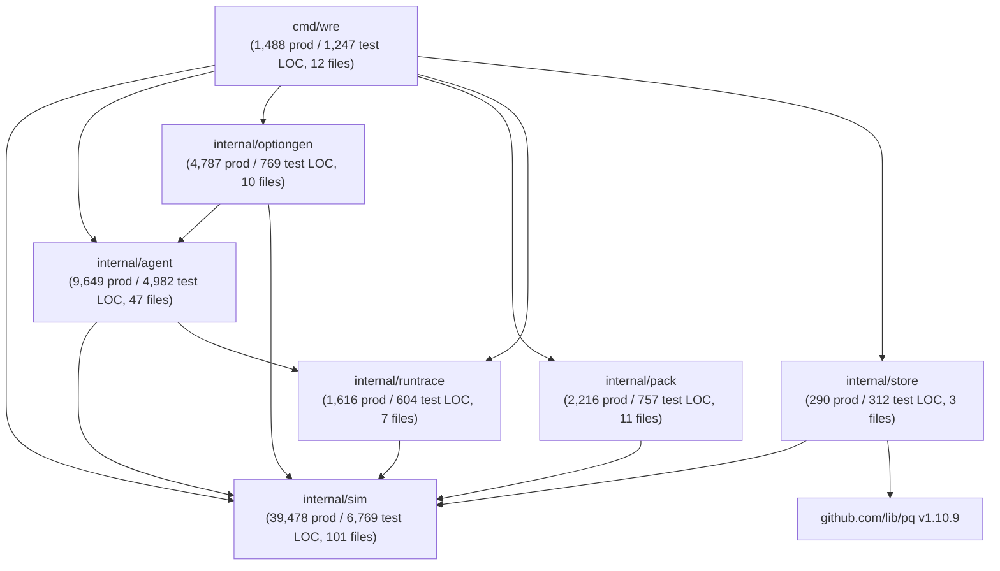

# WRE 全仓依赖图与模块清单（`dependency-map.md`）

> 基线：`dev@58a14c9`（`refactor/architecture-p0-p7`），共 7 个 Go 包、191 个 `.go` 文件、74,964 LOC。

---

## 1. 包级依赖图（Acyclic DAG）

### 包间耦合与反模式清单

| 耦合边 | 具体引用 | 问题定位 | 目标方向 |
|---|---|---|---|
| `agent -> sim` | `agent/pipeline.go` 直接读取 `Perception.Map`/`Catalog` 与 15 个预计算提示字段，并重复实现 40+ 个动作前置检查 | 业务条件双写；`agent` 依赖 `sim` 内部领域细节 | `agent` 通过统一 `ActionCatalog` + `CandidateBuilder` 消费单源条件 |
| `optiongen -> agent` | `optiongen/rulebook.go` 直接构建 `agent.InteractionRulebook`，另写一份 `baseInteractiveEngineActions` | 规则编译器与运行时选择器数据结构强绑定；动作清单分叉 | 规则 schema 下沉为独立不可变 IR，`RuleCompiler` 读取唯一 `ActionCatalog` |
| `runtrace -> sim` | `runtrace.BuildChronicle(events, finalWorld, ...)` 直接接收 `*sim.World` | 叙事层可直接窥探可变世界真相（伪装前阶位、私密野心、全局外交） | 改为接收不可变 `ChronicleSnapshot`（只含公开元数据与事件证据） |
| `pack -> sim` | `pack.Instantiate` 调用 `sim.InitEcology`/`InitProductionAssets`/`EffectiveGovernance` 等默认注入 | 默认值逻辑分散在 `pack` 与 `sim` 两层，且 `<= 0` 回填破坏显式零值 | `pack` 独占编译与默认展开；`sim` 仅执行已编译的明确配置 |
| `cmd/wre -> 全部 6 包` | `main.go:553` 绕过 `DecodeWorldSnapshot`；`main.go:321-336` 分三次提交 DB | 入口层存在反序列化和事务裂口 | 统一经 `sim.DecodeWorldSnapshot` 与 `store.SaveTick` |

---

## 2. `internal/sim/` 54 个非测试文件领域清单

### 2.1 核心模拟循环、世界模型与感知（5 文件 / 5,795 LOC）
| 文件 | LOC | 核心职责 | 跨文件依赖 |
|---|---:|---|---|
| `world.go` | 3,916 | `World`/`Actor`/`Event`/`Action`/`Task`/`Perception`、`Village`、`View`、`Step`、`Advance`、`Apply`/`apply`、`record`、`markDeadIfZero`、`refreshActor` | 依赖全部其余 7 个领域组 |
| `catalog.go` | 1,635 | `Catalog`、`ItemSpec`、`Profession`、`Recipe`、`Capabilities`、`CanLearnProfession` | `environment`, `ecology`, `states_ledgers`, `effects_combat`, `knowledge_laws`, `golden_finger`, `world_events` |
| `environment.go` | 439 | `EnvironmentProfile`、`InstitutionToggles`、通用标签加成 | `catalog`, `world`, `topology` |
| `memory.go` | 300 | `ValidateCitation`、`citedRoot`、`citedReport`、`RecallMemories` | `world`, `continuity` |
| `interactions.go` | 205 | 交互项汇总（供 `Perception.Interactions`） | `world`, `catalog`, `topology` |

### 2.2 多分辨率规模、人口群体与生理（7 文件 / 6,162 LOC）
| 文件 | LOC | 核心职责 | 跨文件依赖 |
|---|---:|---|---|
| `scale.go` | 3,592 | `PopulationCohort`、`LargeWorld`、`buildStepIndex`、`viewIndexed`、`HydrateActor`/`DehydrateActor`、`stepCohorts`、群体市场/冲突、`ScaleSummary` | `world`, `population_members`, `resident_bands`, `cohort_food`, `lifecycle`, `governance`, `logistics`, `ecology`, `market_credit`, `relations_kinship`, `diplomacy`, `spotlight_rumor` |
| `lifecycle.go` | 1,414 | `applyCohortCasualtiesWithCause`、个体与群体伤病/死亡/生育/衰老、20:00 俸禄 | `world`, `scale`, `ecology`, `governance`, `population_members`, `resident_bands`, `states_ledgers` |
| `population_members.go` | 415 | 饥饿/口粮、`detachCohortMembers`、`reconcileCohortMemberChanges`、遗产归公、`placeResident` | `world`, `scale`, `resident_bands`, `states_ledgers`, `lifecycle` |
| `resident_bands.go` | 216 | 匿名居民 RLE 分段（`ResidentBand`）与饥饿守恒 | `scale`, `population_members`, `states_ledgers` |
| `cohort_food.go` | 130 | `settleResidentMeals` 与群体粮食盈余/救济 | `scale`, `population_members`, `resident_bands`, `growth` |
| `relief.go` | 28 | 救济缺口计算 | `catalog`, `cohort_food` |
| `village_food.go` | 27 | 初始村落粮食配给 | `world`, `catalog`, `growth` |

### 2.3 生产、种养、能源与物流（12 文件 / 2,521 LOC）
| 文件 | LOC | 核心职责 |
|---|---:|---|
| `production.go` | 726 | 田地/工坊容量、工具磨损、`RecipeBlockReason`、`InitProductionAssets` |
| `growth.go` | 460 | `GrowthBatch`、`startGrowth`、`AdvanceGrowth`、`harvestGrowth`、`transferGrowingAssets` |
| `logistics.go` | 289 | `PrefectureMap`/`PrefectureFactions`、货运运力与运费结算 |
| `house.go` | 235 | `House`、`weatherHouses`、`SleepRecoveryTenths`（含 `Items["food"]` 硬编码 bug） |
| `farming_living.go` | 169 | 活体牲畜周期供养 |
| `growth_care_actions.go` | 148 | 子分发器 #1：`applyGrowthCareAction` |
| `growth_work.go` | 112 | 看护劳作与收获派发 |
| `production_materials.go` | 106 | 质量/营养转化守恒验证 |
| `farming_delivery.go` | 83 | 跨区收获运输 |
| `shipments.go` | 67 | 在途货物结算 `settleShipments` |
| `energy.go` | 66 | 能源供应与本地能源节点视图 |
| `production_clone.go` | 33 | 生产配置深拷贝 |

### 2.4 经济、市场、信用、挂单与连续计划（4 文件 / 2,715 LOC）
| 文件 | LOC | 核心职责 |
|---|---:|---|
| `market_credit.go` | 1,640 | 子分发器 #3：`ApplyMarketCreditAction`、`StepMarketAndCredit`、囤积/定价/租金/借贷/兼并/基尼系数 |
| `continuity.go` | 864 | 子分发器 #2：`ApplyContinuity`、`AdvanceContinuity`、`ObserveContinuity`、计划与履约协议 |
| `personal_credit.go` | 119 | 个体间个人借贷报价与签发 |
| `offers.go` | 92 | `Offer`、`counterOffer`、`offerSettlementBlockReason`、`offerTax` |

### 2.5 生态、气候、灾变、遭遇与巡防（4 文件 / 2,691 LOC）
| 文件 | LOC | 核心职责 |
|---|---:|---|
| `ecology.go` | 1,916 | `DistrictState`、默认历法/天气/灾害/威胁/祭祀/事故、`InitEcology`、`stepWorldEnvironment` |
| `ecology_process.go` | 474 | 水文路由、生物增殖、`applyEcologyActorExposure` |
| `ecology_patrol.go` | 260 | 群体剿匪/威胁镇压巡防 |
| `ecology_validation.go` | 41 | 生态配置静态校验 |

### 2.6 社会关系、治理、司法、外交与小队（7 文件 / 7,011 LOC）
| 文件 | LOC | 核心职责 |
|---|---:|---|
| `relations_kinship.go` | 2,355 | 子分发器 #4：`ApplyRelationAction`、`StepRelationsAndTurf`、`ObserveCausalRelationEvents`、血亲/继承/血仇/地盘/专营 |
| `justice_revolt.go` | 2,051 | 子分发器 #5：`ApplyJusticeAction`、`StepJusticeAndRevolt`、`openPersonalCase`/`tryPersonalCase`、冤案/抗税/抢粮/起义/大赦 |
| `governance.go` | 933 | `GovernanceSpec`、`TreasuryLedger`、群体日税/保护费/贿赂/御史台反腐 |
| `diplomacy.go` | 822 | 势力盟战和谈、`stepDiplomacy`、`announceDiplomacy`、`perceivedFactionDiplomacy` |
| `party.go` | 562 | 冒险/护卫小队、`stepParties`、背叛与分赃 |
| `offense.go` | 244 | 冒犯累积与爆发临界评估 |
| `mediation_options.go` | 40 | 血仇调解候选构造 |

### 2.7 地理政体、知识法则、状态槽与账本守恒（8 文件 / 5,608 LOC）
| 文件 | LOC | 核心职责 |
|---|---:|---|
| `geography_polity.go` | 1,800 | `GeoRegion`/`Venue`/`PolityNetwork`、`move_venue`、`transmit_message`、`issue_decree`、异常感知 |
| `states_ledgers.go` | 1,794 | `StateSlotSpec`/`FormSpec`/`TransitionSpec`/`FlowGrid`、`LedgerAuditState`、`VerifyLedgerConservation`、`adjust*` 原语雏形 |
| `knowledge_laws.go` | 1,226 | `KnowledgeBook`/`TechSpec`、`research_tech`/`teach_knowledge`/`adopt_facility`/`rewrite_world_law` |
| `topology.go` | 255 | `WorldMap`/`District`/`Road`、Dijkstra 寻路 |
| `ledger_holdings.go` | 211 | `VerifyHoldingBounds` 非负与营养平衡校验 |
| `physical_config.go` | 188 | 物理配置静态校验 |
| `transition_rules.go` | 68 | 突破/形态转换纯前置校验 |
| `production_validation.go` | 66 | 生产配置静态校验 |

### 2.8 战斗、声明式动作、焦点谣言、野心金手指与回放检视（7 文件 / 6,055 LOC）
| 文件 | LOC | 核心职责 |
|---|---:|---|
| `effects_combat.go` | 1,448 | 子分发器 #6：`applyDeclarativeAction`/`finishDeclarativeAction`、`ActiveEffect`、多维战斗结算、`equip`/`unequip` |
| `golden_finger.go` | 1,193 | 通用金手指引擎、`PerceivedFormID` 伪装、`gf_exchange`/`gf_simulate` |
| `spotlight_rumor.go` | 1,029 | 焦点显著性、谣言恐慌放大、动态水合/脱水 |
| `ambitions.go` | 1,027 | 秘密、野心、调查/勒索/曝光/夺权、`captureActionSecrets` |
| `replay_inspect.go` | 807 | 录制/确定性回放、`DecodeWorldSnapshot`、全量检视器 |
| `world_events.go` | 548 | 世界事件触发、冲击、观察与认领 |
| `declarative_costs.go` | 15 | 声明式动作前置消耗扣减 |

---

## 3. 其余 6 个核心包模块清单与入口

| 包 | 核心非测试文件 | 关键导出类型 / 入口 | 当前职责边界问题 |
|---|---|---|---|
| **`internal/agent`** | `pipeline.go` (1,620L), `rules.go` (1,879L), `rulebook.go` (2,983L), `rulebook_jev.go`, `base_rulebook.go`, `playbook.go` (1,438L), `jev.go`, `ambitions_agent.go`, `diplomacy_agent.go`, `party_agent.go`, `golden_finger_agent.go` | `Option`, `Selector`, `Pipeline`, `RuleSelector`, `InteractionRulebook`, `RulebookSelector`, `Playbook`, `PlaybookSelector`, `Jev`, `Options(p)` | 候选生成、规则匹配、状态跟踪、决策选择四者混在同一包甚至同一类型中；`RulebookSelector` 内部字段 `rulebookActorKnowledge` 在每次 `observePerceptionLocked` 被覆写 |
| **`internal/optiongen`** | `rulebook.go` (1,932L), `profile.go`, `expand.go`, `deepseek.go`, `combinations.go`, `responses.go` | `BuildDossier`, `ExpandWorld`, `ExpandResponses`, `BuildWorldOntology`, `SanitizeAndAuditRulebook`, `ExpandWorldRulebook` | 维护独立动作白名单，未对接 `sim.Catalog.ActionSpecs`；放行 `new_primitive:*` 到运行时降级 |
| **`internal/pack`** | `blueprint.go` (910L), `pack.go` (1,263L), `production_validation.go` (43L) | `Blueprint`, `WorldPack`, `LoadBlueprintFile`, `CompileBlueprint`, `LoadFile`, `Validate`, `Instantiate` | 与 `sim` 共享默认值回填，无 `schema_version`，含大量古代中文默认项 |
| **`internal/runtrace`** | `record.go` (129L), `analyze.go` (491L), `chronicle.go` (664L), `query.go` (332L) | `Writer`, `Analyze`, `BuildChronicle`, `RenderChronicleMarkdown`, `BuildChronicleArcs`, `QueryEvents` | `BuildChronicle` 依赖可变 `*sim.World`；未区分已核验事实与未核验谣言；`Analyze` 关闭式 enum 阻碍扩展 |
| **`internal/store`** | `store.go` (290L), `schema.sql` (36L) | `Store`, `Open`, `Init`, `Lock`, `Load`, `Save`, `CompactEvents`, `SaveCheckpoint`, `LoadNearestCheckpoint`, `SaveDecisionLog`, `LoadDecisionLogs`, `LoadEvents` | 无迁移机制；`Save` 与 `SaveDecisionLog`/`SaveCheckpoint` 拆事务；`world_checkpoints`/`world_decision_logs` 缺 FK |
| **`cmd/wre`** | `main.go` (827L), `chronicle.go` (132L), `novel_cli.go` (211L), `trace.go` (32L), `expand_options.go` (102L), `expand_responses.go` (90L), `expand_rulebook.go` (94L) | `runSim`, `inspect`, `replay`, `chronicle`, `blueprint compile`, `pack validate`, `inject`, `query`, `audit-trace`, `expand-*` | `runInspect` 绕过 `DecodeWorldSnapshot`；静默日报硬编码古代财政/抢粮字段 |
